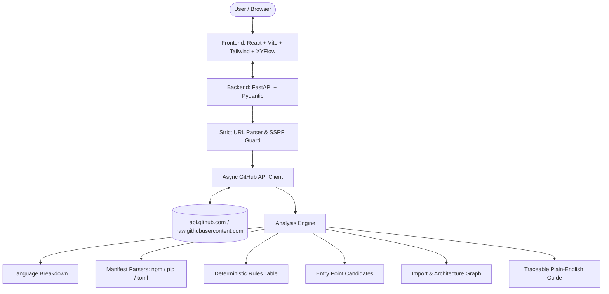

# Repo Archaeologist 🏛️🔍

> **A precision surveying instrument for reading open-source codebases.**
> Paste any public GitHub repository URL and receive an archaeological survey of its structure, dependencies, frameworks, entry point candidates, and architecture graph — backed by verifiable evidence.

---

## About The Project

Repo Archaeologist treats a codebase like an excavation site. Borrowing aesthetic and methodological restraint from surveying and archaeological records:
- **Folders are Strata:** Directory depth is visualized through clean depth rails and hierarchy ticks.
- **Findings are Cataloged Artifacts:** Every detected framework, package manager, and entry candidate is stamped with a catalog identifier (`ART-001`, `ART-002`, ...).
- **Honest Provenance Stamps:**
  - `CONFIRMED` (cyan solid outline): Directly observable facts (e.g. declared in `package.json`, confirmed AST node, lockfile present).
  - `HEURISTIC` (violet dashed outline): Inferred from convention and standard naming (e.g. `main.py`, `src/App.tsx`).
- **Deterministic Rules Only:** 100% deterministic text parsing and API tree analysis. No AI hallucinations, no external paid models, and zero execution of analyzed code.

---

## Architecture Overview



---

## Features

1. **Repository Identity & Vital Stats:** Star count, fork count, open issues, license, push timestamp, and byte-weighted language distribution.
2. **Deterministic Technology Stack:** Frameworks, testing harnesses, styling systems, and container configurations identified from manifests and configs.
3. **Searchable File Tree Explorer:** Depth rail hierarchy, file kind classification (`source`, `test`, `config`, `docs`, `asset`, `data`, `build`, `ci`, `lockfile`), and descriptions for well-known configuration files.
4. **Entry Point Candidates:** Distinguishes manifest-declared binary/script targets from heuristic candidates.
5. **Dependency Stratum:** Runtime vs. development dependencies declared across npm and Python ecosystems (labeled strictly as *"declared in manifest"*).
6. **Architecture Graph:** Interactive node-link diagram distinguishing import relationships, configuration links, and declared dependency edges.
7. **Traceable Survey Guide:** Plain-English summary where every sentence explicitly cites artifact references (`finding_refs`).

---

## Tech Stack

### Frontend
- **Framework:** React 19 / TypeScript / Vite
- **Styling:** Tailwind CSS (Survey Sheet palette) + PostCSS
- **Graph Visualization:** `@xyflow/react`
- **Icons & Routing:** `lucide-react`, `react-router-dom`
- **Testing:** Vitest, React Testing Library

### Backend
- **Framework:** Python 3.11+ / FastAPI / Uvicorn
- **HTTP Client:** `httpx` (async, streaming byte caps)
- **Data Validation:** Pydantic v2
- **Testing:** `pytest`, `pytest-asyncio`, `respx`

---

## Getting Started (Local Setup)

### Prerequisites
- Python 3.11+ (Python 3.14 supported)
- Node.js v20+ (Node v24 supported) and npm

### 1. Backend Setup

```powershell
# Navigate to backend directory
cd backend

# Create virtual environment
python -m venv .venv

# Activate virtual environment (PowerShell)
.\.venv\Scripts\Activate.ps1
# If execution policy blocks activation: Set-ExecutionPolicy -Scope Process -ExecutionPolicy Bypass

# Install dependencies
pip install -r requirements.txt

# Configure environment
Copy-Item .env.example .env
# Optional: Add your classic GitHub token to GITHUB_TOKEN in backend/.env to raise rate limit to 5,000 req/hr

# Run tests
pytest -v

# Start FastAPI server
uvicorn app.main:app --reload --port 8000
```

Verify backend health at: [http://localhost:8000/api/health](http://localhost:8000/api/health)

### 2. Frontend Setup (New Terminal)

```powershell
# Navigate to frontend directory
cd frontend

# Install dependencies
npm install

# Run frontend tests
npm run test

# Start Vite dev server
npm run dev
```

Open the application at: [http://localhost:5173](http://localhost:5173)

---

## Security & Privacy Rules

- **Zero Remote Code Execution:** Analysis is strictly read-only text parsing. Analyzed repository code is never run, installed, or imported.
- **SSRF Defense:** Outbound backend HTTP requests are strictly locked to `api.github.com` and `raw.githubusercontent.com`. Arbitrary URLs, subdomains, IP hosts, and custom ports are rejected.
- **Token Isolation:** The optional `GITHUB_TOKEN` is read exclusively in `backend/app/config.py`, lives only in `backend/.env` (which is `.gitignore`d), and is never exposed in API responses, logs, or client-side bundles.
- **Public Repositories Only:** Only public repository data is accessed. No OAuth write scopes or administrative access are ever requested.

---

## Known Limitations

- Deterministic rules only; no AI-generated code summaries. Descriptions exist only for well-known configuration files.
- Entry points are candidates based on manifest scripts or standard file naming conventions, not proof of runtime execution flow.
- Dependencies are reported as declared in manifest files, not verified as imported in source code.
- Import graph covers local files within the configured byte and file budget. Path aliases, dynamic imports, and complex monorepo workspace configurations are not fully resolved.
- Unauthenticated GitHub API requests are limited by GitHub to ~60 requests per hour. Providing an optional personal access token raises this to 5,000 requests per hour.

---

## License

MIT License. See [LICENSE](LICENSE) for details.
