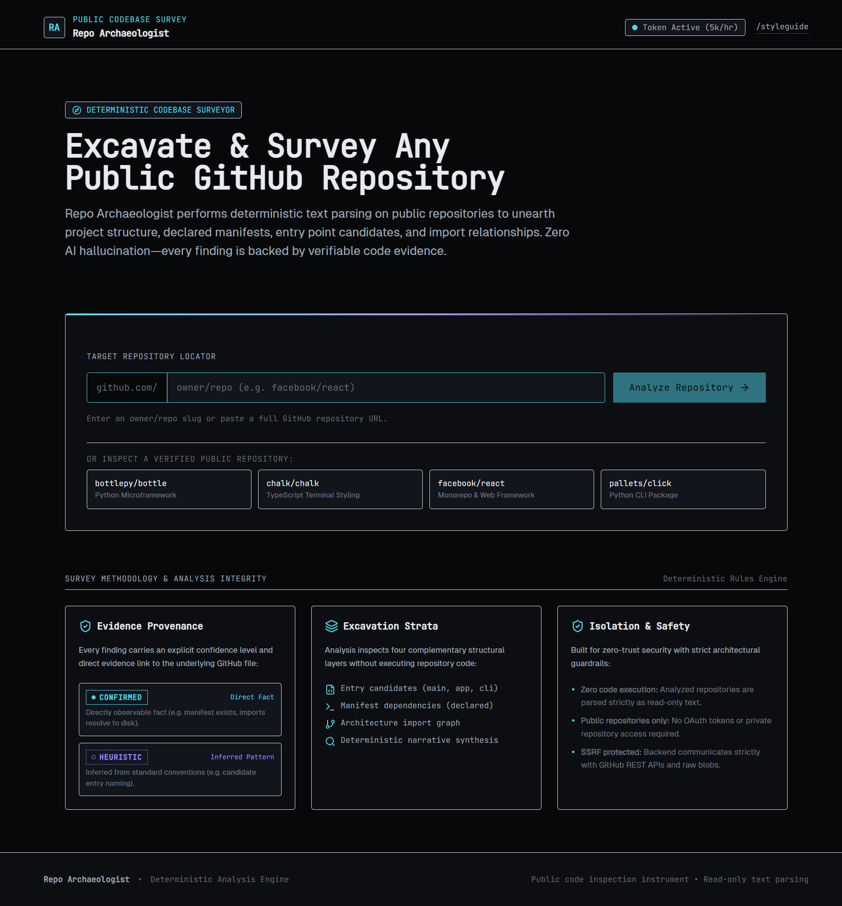
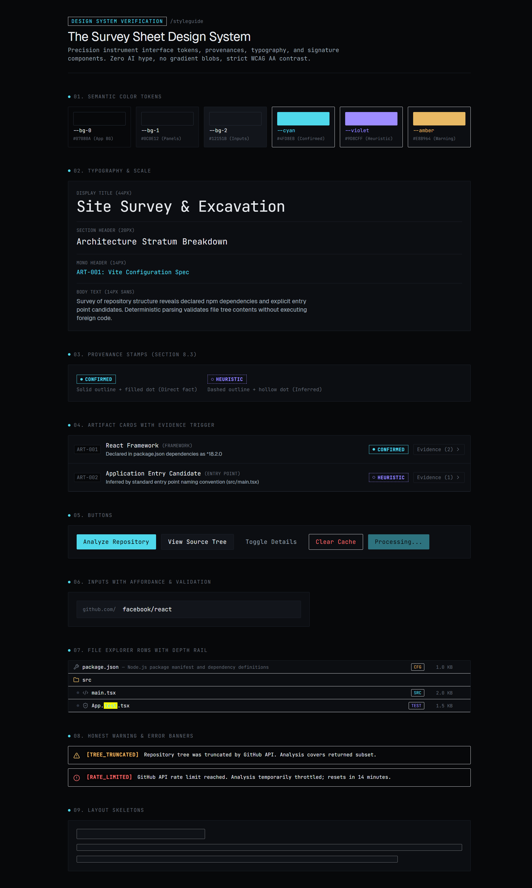
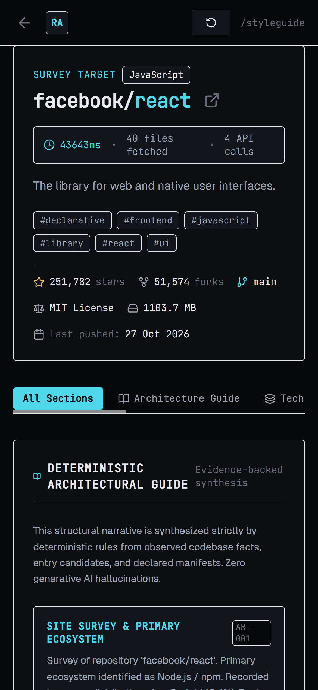
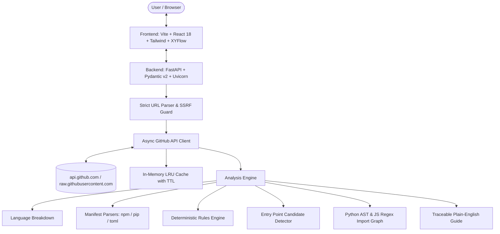

# Repo Archaeologist 🏛️🔍

[](LICENSE)
[](https://www.python.org/)
[](https://fastapi.tiangolo.com/)
[](https://react.dev/)
[](https://www.typescriptlang.org/)
[](https://tailwindcss.com/)
[](https://reactflow.dev/)
[-4FD8EB.svg)](#how-it-works)

> **A deterministic visual surveying instrument for reading open-source codebases.**  
> Paste any public GitHub repository URL and receive an architectural excavation of its structure, declared manifests, entry point candidates, and import topology — strictly backed by verifiable code evidence. Zero AI hallucinations, zero remote code execution.

---

## 🏛️ About The Project

Navigating a massive, unfamiliar codebase often forces developers to choose between superficial README claims and unpredictable, hallucination-prone AI summarizers.

**Repo Archaeologist** takes an entirely different approach: it treats a codebase like an **archaeological excavation site**, borrowing the aesthetic and methodological restraint of surveying instruments:

- **Folders are Strata:** Directory depth is visualized through clean depth rails, hierarchy lines, and file kind classifications.
- **Findings are Cataloged Artifacts:** Every detected framework, package manager, build tool, and entry candidate is assigned a catalog identifier (`ART-001`, `ART-002`, ...).
- **Calibrated Provenance Stamps:**
  - `CONFIRMED` *(Solid Cyan Outline + Filled Dot)*: Directly observable codebase facts (e.g., manifest exists, declared dependency in `package.json`, AST import resolves to disk).
  - `HEURISTIC` *(Dashed Violet Outline + Hollow Dot)*: Inferred from standard ecosystem conventions (e.g., entry naming patterns like `src/main.tsx` or `main.py`).
- **Deterministic Rules Only:** 100% deterministic text parsing, static AST analysis, and GitHub tree inspection. Every sentence in the synthesized guide traces directly to verifiable evidence.

---

## 📸 Visual Showcase

### 1. The Excavation Transit (Landing Page)
*Geological strata hero, real-time input validation, live API rate-limit pill, and verified quick-start chips.*



---

### 2. Full Codebase Survey Dashboard (`facebook/react`)
*Complete excavation showing metadata, language distribution, architectural narrative, 21 entry candidates, 285 declared dependencies, 7,924 file nodes, and README.*


---

### 3. "The Survey Sheet" Design System (`/styleguide`)
*Precision instrument palette, provenance stamps, artifact cards, evidence drawers, and depth-rail explorer rows.*



---

### 4. Responsive Mobile Survey (390 px)
*Seamless mobile experience with sticky header, touch-friendly tab switching, and card stacking.*

<p align="center">
  
</p>

---

## ⚡ Key Features

1. **Repository Identity & Vital Stats:**
   - Real-time stars, forks, open issues, default branch, license, size, and last commit timestamp.
   - Exact execution telemetry: milliseconds elapsed, files fetched, and GitHub API calls consumed.

2. **Deterministic Technology Stack & Manifest Audit:**
   - Detects frameworks, build tools, package managers, test harnesses, and styling engines.
   - Stacked language distribution bar weighted by byte volume.
   - Every finding features an interactive **Evidence Drawer** showing the exact file path and justification with direct GitHub links.

3. **Entry Point Candidates:**
   - Distinguishes confirmed binary and script targets from heuristic entry candidates.
   - Labeled strictly as *"entry point candidates"* to prevent assuming execution flow.

4. **Declared Dependencies Audit:**
   - Categorized by manifest (`package.json`, `requirements.txt`, `pyproject.toml`, `go.mod`, `Cargo.toml`).
   - Grouped into **Runtime** vs. **Development** dependencies with version specifications.
   - Labeled strictly as *"declared in manifest, not proven used"*.

5. **Searchable File Tree Explorer:**
   - Collapsible folder tree with depth rails.
   - Real-time instant keyword filter with yellow match highlights.
   - File kind tags: `CFG` (Config), `SRC` (Source), `TEST` (Tests), `DOC` (Documentation), `CI` (Build & Workflows), `LOCK` (Lockfiles).
   - File size indicators in KB and direct links to GitHub files.

6. **Deterministic Architectural Guide:**
   - Plain-English structural narrative synthesized from observed facts.
   - Every statement cross-references an artifact catalog ID (`[ART-001]`, `[ART-002]`).

7. **Architecture Import Graph (`@xyflow/react`):**
   - Interactive node-link topology distinguishing source modules, entry files, configs, and dependencies.
   - Distinct edge aesthetics (solid, dashed, dotted) with full interactive pan, zoom, minimap, and node inspector.

---

## 🛠️ Architecture & Data Flow



---

## 🔬 How It Works (Anti-Hallucination Integrity)

Repo Archaeologist adheres to a strict anti-hallucination protocol:

1. **Zero Foreign Code Execution:** Repositories are parsed strictly as read-only text blobs. Foreign code is never executed, installed, imported, or run in a sandbox.
2. **Prioritized File Budgeting:** Analysis avoids greedy cloning. It downloads the repository git tree, prioritizes up to 40 critical manifest/entry files, imposes a strict 100 KB per-file cap, and halts at a 2 MB total ceiling.
3. **AST & Regex Import Extraction:** Python imports are parsed using Python's native `ast` module; JavaScript and TypeScript imports are extracted via regex against ECMAScript specifications.
4. **Honest Warnings for Partial Surveys:** If a file exceeds the cap or a tree is truncated by GitHub API limits, honest warning banners (`[FILE_OVERSIZED]`, `[TREE_TRUNCATED]`) are prominently displayed.

---

## 🚀 Getting Started (Local Setup)

### Prerequisites
- **Python 3.11+** (Python 3.14 fully tested)
- **Node.js v20+** (Node v24 fully tested) and **npm**

---

### Step 1: Backend Setup (Terminal 1)

```powershell
# Navigate to backend
cd backend

# Create and activate Python virtual environment (Windows PowerShell)
python -m venv .venv
.\.venv\Scripts\Activate.ps1

# Note: If PowerShell execution policy blocks scripts:
# Set-ExecutionPolicy -Scope Process -ExecutionPolicy Bypass

# Install pinned dependencies
pip install -r requirements.txt

# Create environment configuration from template
Copy-Item .env.example .env

# Optional: Add your GitHub Personal Access Token to backend/.env
# GITHUB_TOKEN=ghp_... (Public read-only access, zero scopes needed)
# Raises API rate limit from 60 to 5,000 requests/hour

# Run backend unit tests
pytest -v

# Start FastAPI development server
uvicorn app.main:app --reload --port 8000
```

Verify backend health at: [http://localhost:8000/api/health](http://localhost:8000/api/health)

---

### Step 2: Frontend Setup (Terminal 2)

```powershell
# Navigate to frontend
cd frontend

# Install pinned dependencies
npm install

# Run frontend unit tests
npm run test

# Run TypeScript lint / type-checking
npm run lint

# Start Vite dev server
npm run dev
```

Open the application in your browser: [http://localhost:5173](http://localhost:5173)  
Or view the design system directly: [http://localhost:5173/styleguide](http://localhost:5173/styleguide)

---

## 🔒 Security & Privacy Guardrails

| Guardrail | Implementation & Verification |
|---|---|
| **Zero Remote Code Execution** | Read-only static analysis only. Code is never imported, evaluated, or executed. |
| **SSRF Defense** | Outbound requests restricted strictly to `api.github.com` and `raw.githubusercontent.com`. Arbitrary URLs, custom ports, and credentials are rejected. |
| **Token Isolation** | `GITHUB_TOKEN` is loaded solely in `backend/app/config.py`. It is `.gitignore`d, omitted from health checks, redacted from logs, and completely absent from client builds. |
| **CORS Policy** | Restricted strictly to `http://localhost:5173` and `http://127.0.0.1:5173`. Wildcards (`*`) are disallowed. |
| **Public Repositories Only** | Operates strictly on open-source public repositories. Zero OAuth write scopes or user token storage. |

---

## 📁 Project Structure

```
Repo Archaeologist/
├── backend/
│   ├── app/
│   │   ├── analysis/          # Deterministic rules, detectors, graph & guide
│   │   ├── api/               # FastAPI endpoints (/api/health, /api/analyze)
│   │   ├── github/            # URL parser, async client, rate limits, error mapping
│   │   ├── cache.py           # In-memory TTL cache with LRU eviction
│   │   ├── config.py          # Pydantic settings & environment isolation
│   │   ├── logging_config.py  # Redacted logging formatters
│   │   └── main.py            # FastAPI entry point & CORS configuration
│   ├── tests/                 # 148 passing Pytest unit tests & fixtures
│   ├── requirements.txt       # Pinned backend dependencies
│   └── .env.example           # Safe environment template
├── frontend/
│   ├── src/
│   │   ├── api/               # Typed API client layer (zero fetch in components)
│   │   ├── components/
│   │   │   ├── artifacts/     # ArtifactCard, EvidenceDrawer
│   │   │   ├── dashboard/     # Header, TechStack, EntryPoints, Dependencies, Explorer
│   │   │   └── ui/            # ProvenanceStamp, Button, Input, Banner, Skeleton
│   │   ├── lib/               # Client-side URL validation matching backend rules
│   │   ├── pages/             # LandingPage, ResultsDashboard, StyleguidePage
│   │   ├── types/             # TypeScript data contract synchronized with backend
│   │   ├── App.tsx            # Application router
│   │   └── main.tsx           # React entry point
│   ├── DESIGN_BRIEF.md        # The Survey Sheet design specification
│   ├── package.json           # Pinned frontend dependencies
│   ├── tailwind.config.ts     # Custom theme tokens & font families
│   └── vite.config.ts         # Vite bundler, proxy & Vitest setup
├── docs/
│   └── screenshots/           # Full-fidelity 1440px and 390px verification captures
├── AGENTS.md                  # Workspace constraints & honesty protocol
├── LICENSE                    # MIT License
└── README.md                  # Project overview & documentation
```

---

## ⚠️ Known Limitations

- **Deterministic vs. Generative:** Explanations and descriptions exist exclusively for cataloged configuration files and detected frameworks. The engine will never invent code descriptions.
- **Entry Candidates:** Files like `main.py` or `src/main.tsx` are identified as candidate entry points based on standard naming or manifest scripts; they are not runtime execution traces.
- **Dependency Scope:** Dependencies are parsed as declared in manifest files; source code is not parsed for dynamic `require()` or runtime module imports outside the budget.
- **Rate Limits:** Unauthenticated GitHub API calls are limited to 60 requests/hour by GitHub. Setting an optional read-only token in `backend/.env` raises this limit to 5,000 requests/hour.

---

## 📄 License

This project is open-source under the [MIT License](LICENSE).
